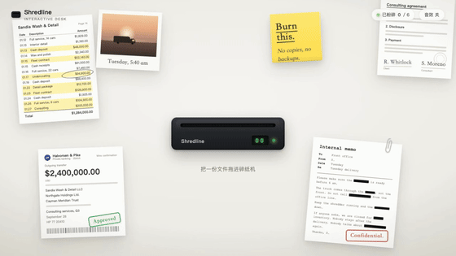
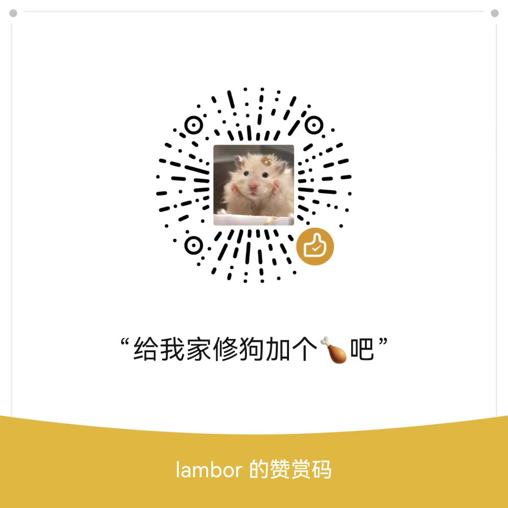
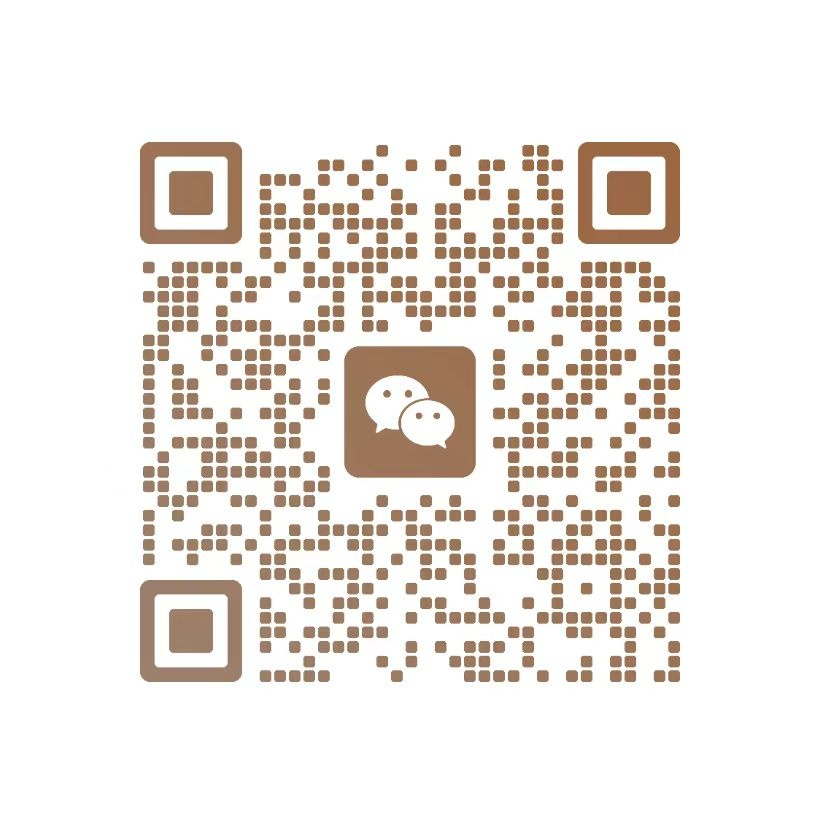

# Shredline

一个用原生 HTML、CSS、JavaScript 实现的碎纸机桌面交互。桌面上散落着发票、照片、便利贴、合同、电汇单和内部备忘录，把任意一份文件拖进碎纸机，它会被卷入刀口、绞成带印刷痕迹的碎条，在桌面底部堆成纸屑堆。适合创意落地页、交互 demos 和"销毁证据"主题的小彩蛋。

无需安装依赖或构建，启动本地 HTTP 服务即可体验。

## 效果演示

下方动图直接展示完整流程：拖拽文件、进纸口高亮、粉碎动画、纸屑堆积与互动、全部粉碎后的自动重置，无需跳转。



高清完整视频（44 秒，1280×720）见 [assets/demo/shredline-demo.mp4](assets/demo/shredline-demo.mp4)。

## 快速开始

在项目根目录运行：

```sh
python3 -m http.server 8000
```

浏览器打开 [http://127.0.0.1:8000/](http://127.0.0.1:8000/)。

## 交互与功能

- **拖拽粉碎**：抓起任意文件拖到碎纸机进纸口，槽口橙色高亮、LED 变黄提示可以松手；没对准则文件弹回原位。
- **卷入动画**：纸张底边抵住进纸口后被遮罩裁切，形成"被刀辊卷入"的效果；出纸口同步吐出一小段纸带，内容是原纸克隆随喂入进度滑动，底边不断撕成锯齿。
- **碎纸粒子**：碎条为预渲染的 canvas 贴纸，按文件类型绘制印刷痕迹——文件是裁断的文字行，便利贴是手写笔迹，照片是渐变色彩；碎条飘落并在桌面底部堆积，极缓慢消散。
- **纸屑堆互动**：点击纸屑堆把碎片踢起来；短时间内连续点击积攒能量，碎片悬浮得越来越高。
- **视差镜头**：场景随鼠标位置轻微平移，营造桌面纵深感。
- **状态反馈**：碎纸机 LCD 计数、右上角计数胶囊同步更新；全部 6 份文件粉碎后显示收尾文案并自动复位。
- **音效开关**：碎纸声由 WebAudio 实时合成（噪声 + 带通/低通滤波），默认关闭，点击右上角按钮开启。
- **移动适配**：小屏自动缩放场景，支持触摸拖拽。

## 项目结构

| 文件 | 用途 |
| --- | --- |
| `index.html` | 页面结构，6 份文件与碎纸机的 DOM |
| `script.js` | 拖拽交互、粉碎动画、粒子系统、视差与音效 |
| `style.css` | 桌面场景、文件样式、碎纸机与各状态样式 |
| `assets/demo/` | 演示动图、视频与封面 |
| `assets/` | 赞赏码与联系方式二维码 |

## 实现说明

粉碎动画用 DOM + Web Animations API 完成：粉碎时给场景套一个底边对齐进纸口的遮罩容器，纸张在遮罩内滑入，超出部分被裁掉，无需切分 DOM 即得到"卷入"效果。出纸口纸带内嵌原纸的克隆节点，按喂入进度下移，只露出已卷入的那一段真实内容。

碎条贴纸按文件调色板预渲染并缓存，粒子系统按帧率无关的时间步长更新，落地后进入静止堆积状态。视差通过 CSS transform 作用于整个场景，拖拽时按缩放比换算指针坐标，保证任何窗口尺寸下手感一致。

演示视频由 Playwright 脚本自动操作页面录制，再用 ffmpeg 转码为 mp4 与 gif。

## 赞赏与联系

如果这个项目对你有帮助，欢迎扫码赞赏，给我家小狗加个鸡腿 🍗。感谢你的支持！

如需功能定制或网站接入，欢迎添加微信：**Rambo_Gong**，一起聊聊你的需求。

| 赞赏支持 🍗 | 微信联系 |
| :---: | :---: |
|  |  |
